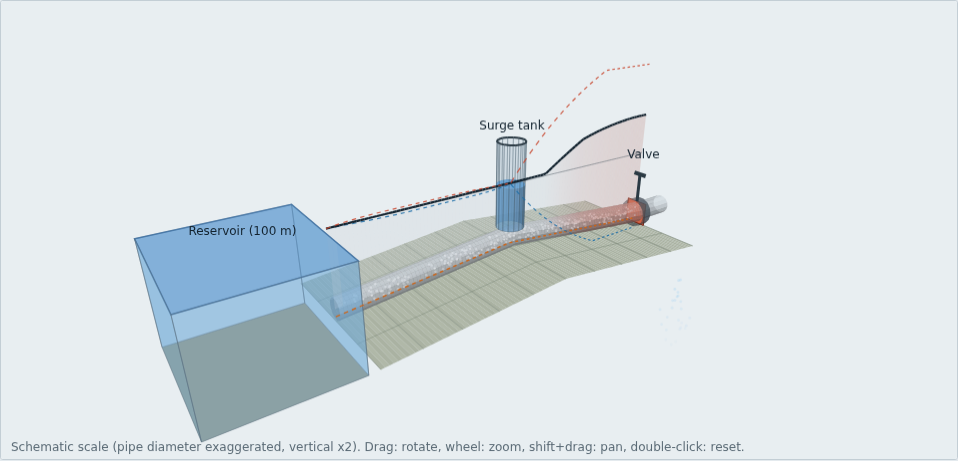
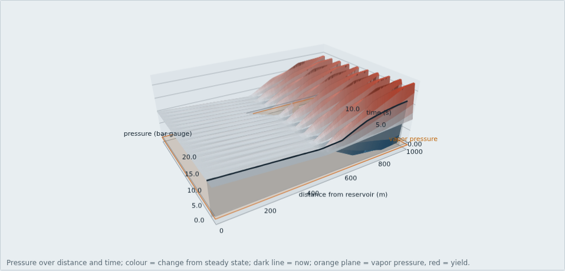
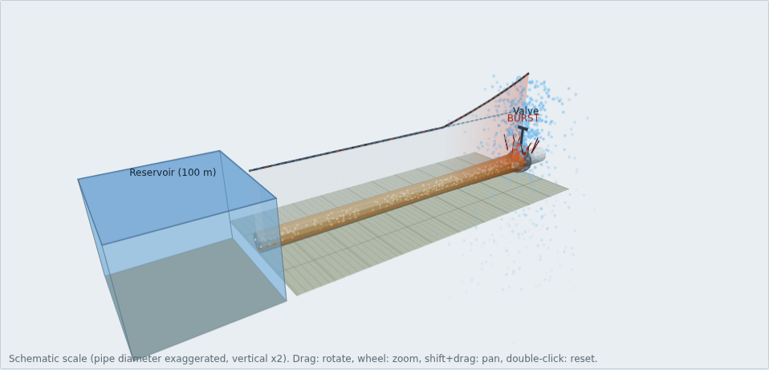

# Water Hammer Lab

**[Open the simulator](https://biswashk920.github.io/water-hammer-lab/)**  |  [Source code](https://github.com/biswashk920/water-hammer-lab)

An interactive water hammer (pressure surge) simulator that runs in the browser. It solves a reservoir, pipe and valve system with the Method of Characteristics and shows the result in 2D and 3D. The solver is written in JavaScript and checked against a separate Python implementation.



## What it does

- Simulates a valve closing at the end of a pipe fed by a reservoir. Inputs are the pipe geometry and material, flow velocity, reservoir level, friction factor, and the closure time and shape (linear or two-stage).
- Computes the wave speed from the fluid bulk modulus, the pipe modulus, the diameter to wall thickness ratio and the pipe support condition.
- Takes a pipe elevation profile (flat, downhill, hill, valley or custom) so you can see where the pressure is lowest.
- Optional open surge tank at any point along the pipe, with its own diameter, height and connecting orifice.
- Calculates hoop stress and the factor of safety along the whole pipe. If the factor of safety falls below 1 the pipe bursts and the simulation ends. If it falls below the value you require (default 2), the page suggests a wall thickness.
- Warns when the pressure drops below vapor pressure.

Steel, ductile iron, PVC and HDPE are available as presets. The yield strengths used for the safety check are 240, 290, 48 and 24 MPa. Change them to match your actual material.

## Views

- **2D schematic**: pipe coloured by pressure change, with the surge tank, valve and burst.
- **3D scene**: terrain, reservoir, valve, surge tank, the pipe coloured by pressure and local factor of safety, a curtain showing the hydraulic grade line (with the steady line, the max and min envelopes and the vapor pressure limit), flow particles moving at the solved local velocity, and a burst with flared wall, spray and shockwave.
- **3D pressure surface**: pressure against distance and time, with a time cursor and planes for vapor pressure and yield pressure.

Drag to rotate, scroll to zoom, shift+drag to pan, double-click to reset the camera. The 3D views use plain canvas with no libraries, so the page works offline. The pipe diameter and the particle speed are exaggerated for visibility. Heads and elevations share one vertical scale.

| Pressure surface | Burst |
| --- | --- |
|  |  |

## Model

- Method of Characteristics on a fixed grid, Courant number 1, with explicit quasi-steady Darcy-Weisbach friction.
- Upstream boundary: reservoir at constant level. Downstream boundary: valve discharging to atmosphere, modelled as an orifice with an effective opening fraction.
- Elevation: the solver works in piezometric head, so the head solution does not depend on elevation. Elevation sets the pressure head (H - z) used for stress, burst, the vapor pressure check and the surge tank bottom. The valve is the elevation datum. A pipe crest above the hydraulic grade line in steady flow is rejected.
- Hoop stress = rho * g * H * (D + e) / (2e), using gauge pressure, mean diameter and thin-wall theory. Factor of safety = yield strength / peak hoop stress over the whole pipe and run.
- Surge tank: level from a trapezoidal volume balance, connected through an orifice (Cd 0.8, loss K * q * |q|, the same in both directions). The level starts at the steady head at that point. A full tank spills and holds its top level. An empty tank stops supplying water.

## Verification

The Python reference in `python/moc.py` checks the solver against known results:

- A steady state with the valve open stays unchanged.
- With no friction and instant closure, the peak equals the Joukowsky value (a * dV / g) and the valve pressure has period 4L/a.
- A slow closure stays below the Joukowsky peak and within a factor of 0.5 to 1.5 of the Michaud estimate.
- The peak pressure converges as the grid is refined (50, 100 and 200 reaches agree within 0.02%).
- Friction reduces successive peaks.
- Hoop stress matches a hand calculation, and the burst step matches a brute-force search.
- The suggested wall thickness gives a factor of safety of at least the required value, and 0.1 mm less does not.
- Surge tank: a very small tank gives the no-tank result, a very large tank acts as a second reservoir, continuity and the orifice law hold exactly, and the mass oscillation period and amplitude match the standard formulas (210.4 s and 3.01 m in the test case).
- Elevation: the head solution is independent of elevation, and a crest above the hydraulic grade line is rejected.

`web/test_js.js` then checks that the JavaScript solver reproduces the Python results to within 1e-8. `tests/browser_test.js` loads the page in Chromium, exercises each view and feature (including mouse interaction, a phone-sized viewport and error messages), and fails on any console error.

## Run locally

Open `web/index.html` in a browser. No build step or server is needed.

To run the tests:

```
cd python && python3 moc.py          # needs numpy
cd ../web && node test_js.js
cd ..                                # back to the repository root
npm i playwright && npx playwright install chromium
node tests/browser_test.js
```

## Publish with GitHub Pages

In the repository settings, go to Pages, choose "Deploy from a branch", select the main branch and the root folder. The root `index.html` redirects to the app in `web/`.

## Limits

- Cavitation and column separation are not modelled. The page flags when pressure falls below vapor pressure, and results after that point are not valid.
- Friction is quasi-steady. There is a single pipe with constant diameter, wall and material between one reservoir and one valve.
- No pumps, air vessels, one-way tanks, fittings or branches.
- The surge tank is open, with one orifice and its bottom at the pipe axis. Air entering an empty tank is not modelled.
- Burst means the hoop stress reached the yield strength. This is conservative for ductile metals. Fatigue from repeated surges and vacuum collapse are not checked.
- Very long runs (many reaches over many seconds) are refused to keep memory use reasonable.
- In the 3D view, translucent parts are sorted back to front, so overlapping transparent surfaces can occasionally layer imperfectly.

This is a learning and screening tool. Do not use it as the only basis for the design of a real pipeline.

## License

MIT. See [LICENSE.txt](LICENSE.txt). Copyright (c) 2026 Biswash Kaphle.
